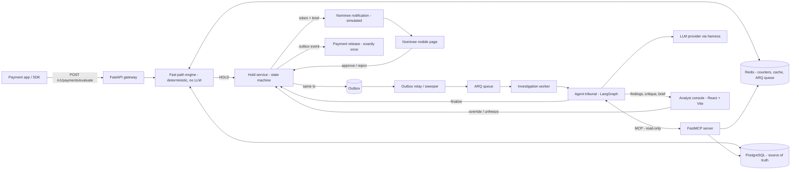
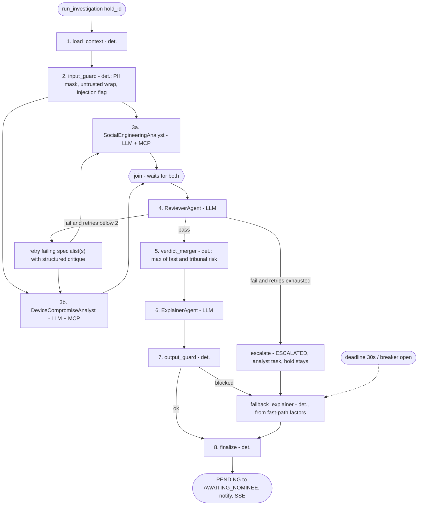
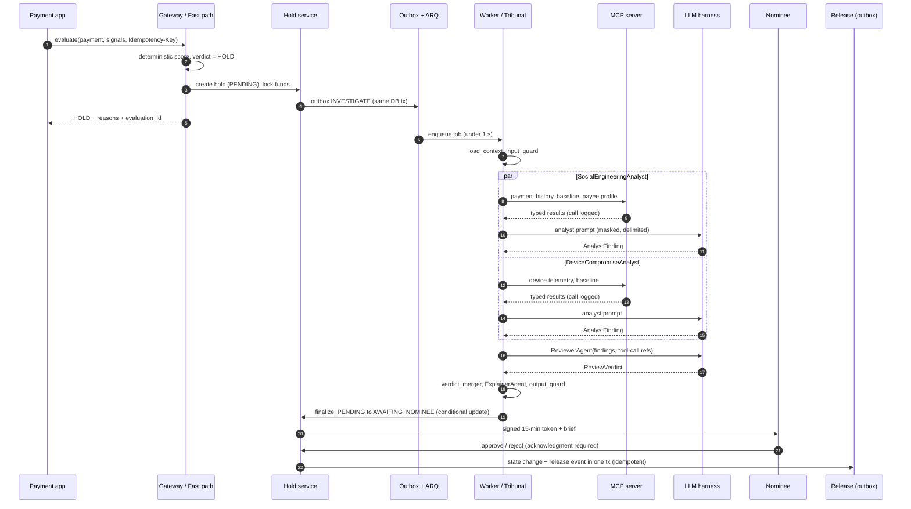
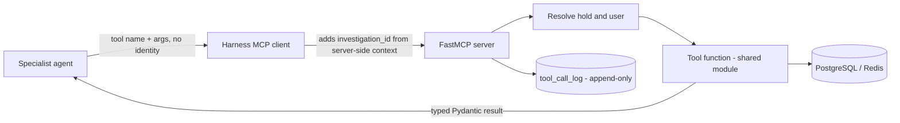
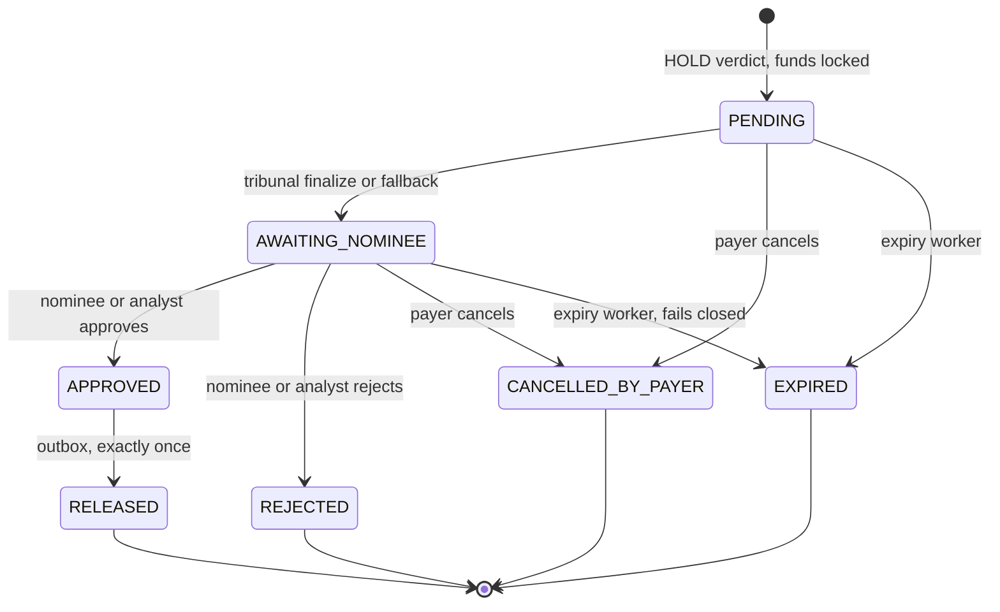

# FinShield Agent Architecture

> **Status:** Draft v0.1 · **Derived from:** SRS v0.1 (15 Oct 2026), section 3.5 (Agent tribunal) and its dependencies
> **Scope:** the asynchronous multi-agent investigation ("tribunal") triggered by a HOLD, and how it plugs into the rest of FinShield.

---

## Table of contents

1. [Design principles](#1-design-principles)
2. [System context](#2-system-context)
3. [Tribunal graph](#3-tribunal-graph)
4. [End-to-end sequence](#4-end-to-end-sequence)
5. [Agent roster](#5-agent-roster)
6. [State and schemas](#6-state-and-schemas)
7. [MCP tool layer](#7-mcp-tool-layer)
8. [Hold state machine and tribunal hand-off](#8-hold-state-machine-and-tribunal-hand-off)
9. [Failure, retry and deadline semantics](#9-failure-retry-and-deadline-semantics)
10. [Guardrails and security](#10-guardrails-and-security)
11. [Harness, cost and observability](#11-harness-cost-and-observability)
12. [Data touchpoints](#12-data-touchpoints)
13. [Module layout](#13-module-layout)
14. [Testing strategy](#14-testing-strategy)
15. [Requirement traceability](#15-requirement-traceability)
16. [Acceptance scenarios](#16-acceptance-scenarios)
17. [Open decisions](#17-open-decisions)

---

## 1. Design principles

| # | Principle | Source |
|---|-----------|--------|
| P1 | **Deterministic first, agents advisory.** The fast path decides the verdict. Agents only recommend. | ADR3, FR-508 |
| P2 | **LLMs never touch state or money.** Every state transition, freeze, release and block is done by deterministic code. | FR-508, FR-407 |
| P3 | **Risk can only go up.** `final_risk = max(fast_path_risk, tribunal_risk)`. A fast-path HOLD is released only by the nominee or a human analyst. | FR-409, FR-1505 |
| P4 | **MCP is the only data channel for agents.** Tools are defined once, read-only, with identity bound server-side. | FR-601, FR-602, ADR6 |
| P5 | **Typed everywhere.** Frozen state, Pydantic outputs, typed tool results. Invalid output is retried within a hard cap. | FR-505, FR-506, FR-603 |
| P6 | **Fail closed.** Timeouts, breaker trips and exhausted retries degrade to a deterministic explanation. The hold is never released by the tribunal. | FR-507, FR-406, ADR5 |
| P7 | **Untrusted text stays untrusted.** PII masked and free text delimited before any LLM context. | FR-801 to FR-803 |

---

## 2. System context



---

## 3. Tribunal graph

Nodes marked **LLM** call a model through the harness. All other nodes are deterministic.



**Notes**

- The fan-out to 3a and 3b is parallel. The join is explicit (FR-502).
- The retry loop re-runs **only the specialist(s) the reviewer flagged**, up to 2 retries each (FR-503). Schema-invalid output counts against the same cap (FR-505).
- Any path that cannot produce a reviewed brief converges on `fallback_explainer`, then `finalize`. The graph always terminates.

---

## 4. End-to-end sequence



---

## 5. Agent roster

| Component | Kind | Model tier | MCP tools | Input | Output |
|-----------|------|-----------|-----------|-------|--------|
| `load_context` | Deterministic | n/a | n/a | `hold_id` | Evaluation record, factors, signals, classification rationale |
| `input_guard` | Deterministic | n/a | n/a | Raw free text | Masked, delimited text, `injection_flagged` |
| **SocialEngineeringAnalyst** | LLM | Light | `get_payment_history_summary`, `get_baseline_summary`, `get_payee_profile` | Sanitized memo, payee info, history | `AnalystFinding` |
| **DeviceCompromiseAnalyst** | LLM | Light | `get_device_telemetry`, `get_baseline_summary` | Signals, telemetry, rationale | `AnalystFinding` |
| **ReviewerAgent** | LLM | Strong (see [open decisions](#17-open-decisions)) | None | Both findings, tool-call refs | `ReviewVerdict` |
| `verdict_merger` | Deterministic | n/a | n/a | Fast-path risk, tribunal risk | `final_risk` (never below fast path) |
| **ExplainerAgent** | LLM | Light | None | Validated, merged findings | `NomineeBrief` (EN, optional HI) |
| `output_guard` | Deterministic | n/a | n/a | Brief | Pass or block (legal claims, advice, named accusations) |
| `fallback_explainer` | Deterministic | n/a | n/a | Fast-path factors | Template brief |
| `finalize` | Deterministic | n/a | n/a | Final state | Persisted investigation, hold transition, notification, SSE event |

**Least privilege:** the reviewer and explainer have no tools. Only the two specialists can read data, and only through MCP.

---

## 6. State and schemas

### 6.1 `InvestigationState` (frozen, FR-506)

```python
from pydantic import BaseModel, ConfigDict
from typing import Literal

class InvestigationState(BaseModel):
    model_config = ConfigDict(frozen=True)

    investigation_id: str
    hold_id: str
    evaluation_id: str

    fast_path: FastPathSnapshot          # verdict, risk, factors, classification + rationale
    sanitized: SanitizedInputs           # masked and delimited free text
    injection_flagged: bool = False

    social: AnalystFinding | None = None
    device: AnalystFinding | None = None
    review: ReviewVerdict | None = None
    attempts: dict[str, int] = {}        # per-specialist retry counters, cap 2

    final_risk: float | None = None
    brief: NomineeBrief | None = None
    status: Literal["RUNNING", "COMPLETED", "FALLBACK", "ESCALATED"] = "RUNNING"
```

Nodes return updates (`state.model_copy(update=...)` or a partial dict). The two parallel branches write to separate keys, so the join has no write conflicts.

### 6.2 Agent output schemas (FR-505)

```python
class ToolCallRef(BaseModel, frozen=True):
    call_id: str
    tool: str
    result_hash: str

class AnalystFinding(BaseModel, frozen=True):
    agent: Literal["social_engineering", "device_compromise"]
    risk: float                  # 0..1
    confidence: float            # 0..1
    flags: list[Flag]            # enum, e.g. COACHING_LANGUAGE, URGENCY, DIGITAL_ARREST, REMOTE_TOOL
    reasoning: str
    evidence: list[ToolCallRef]  # every claim traceable to a logged tool call

class ReviewIssue(BaseModel, frozen=True):
    target_agent: Literal["social_engineering", "device_compromise"]
    kind: Literal["SCHEMA", "UNGROUNDED_CLAIM", "INCONSISTENT", "ROLE_VIOLATION", "OTHER"]
    detail: str

class ReviewVerdict(BaseModel, frozen=True):
    passed: bool
    issues: list[ReviewIssue]
    retry_targets: list[Literal["social_engineering", "device_compromise"]]

class NomineeBrief(BaseModel, frozen=True):
    reasons: list[str]                 # specific reasons for the hold (FR-1503)
    summary: dict[Literal["en", "hi"], str]
    call_first_prompt: str             # prompt to call the payer on a known number first
    requires_ack: bool = True          # explicit acknowledgment before approve is enabled
```

---

## 7. MCP tool layer

Each tool is defined **once** in a shared module and exposed **only** through a FastMCP server (FR-601). There is no parallel direct implementation.

| Tool | Returns (Pydantic) | Used by | Notes |
|------|--------------------|---------|-------|
| `get_device_telemetry` | `DeviceTelemetry` | DeviceCompromiseAnalyst | Read-only |
| `get_payment_history_summary` | `PaymentHistorySummary` | SocialEngineeringAnalyst | Aggregated, not raw rows |
| `get_baseline_summary` | `BaselineSummary` | Both specialists | 90-day baseline stats |
| `get_payee_profile` | `PayeeProfile` | SocialEngineeringAnalyst | Known or new payee, blacklist status |

**Identity binding (FR-602).** The harness opens one MCP session per investigation with `investigation_id` held in server-side context. The server resolves it to the hold and user. Tool schemas contain **no** `user_id` or `session_id` parameters, so the model cannot request another user's data.

**Audit and budget.**

- Every call is appended to `tool_call_log` (investigation id, tool, args, result hash), immutable (FR-604).
- A per-investigation tool-call budget is enforced in the MCP layer (FR-605, P1).
- The reviewer checks each `evidence` reference in a finding against the logged result hashes to catch hallucinated facts about the payer.



---

## 8. Hold state machine and tribunal hand-off

Every transition is a single atomic conditional update (`WHERE state = <expected>`). Zero rows affected means the transition is refused (FR-402). Every transition is written to the append-only audit log (FR-410).



**Tribunal rules at the boundary**

- The worker performs `PENDING to AWAITING_NOMINEE` as actor `tribunal-worker` through the same hold service the endpoints use. It never writes state directly.
- If the payer cancelled, or the hold expired, while the investigation ran, the conditional update affects zero rows. The refusal is logged and the result is discarded.
- No agent output can cause `APPROVED`, `RELEASED`, a freeze, or a block.

---

## 9. Failure, retry and deadline semantics

| Condition | Behavior | Hold state | Req |
|-----------|----------|-----------|-----|
| Normal completion (typical 2 to 4 s) | Reviewed brief, `status = COMPLETED` | to `AWAITING_NOMINEE` | FR-507 |
| Specialist output invalid or reviewer fails | Retry only the failing specialist(s) with structured critique, max 2 | `PENDING` | FR-503, FR-505 |
| Retries exhausted | `status = ESCALATED`, analyst task created, deterministic brief | Hold stays in place | FR-503 |
| 30 s deadline exceeded | Cancel graph, `fallback_explainer`, `status = FALLBACK` | to `AWAITING_NOMINEE` (see open decision 2) | FR-507 |
| Circuit breaker open or LLM outage | Same as deadline | same | FR-1001 |
| `output_guard` blocks the brief | Fallback brief | same | FR-804 |
| Duplicate job delivery (ARQ at-least-once) | No-op via unique `investigations(hold_id)` | unchanged | FR-501 |
| Hold already cancelled or expired | Transition refused, result discarded | unchanged | FR-402 |
| Any failure | **Never** releases the payment | n/a | NFR-3, ADR5 |

---

## 10. Guardrails and security

**Input side (before any LLM call)**

1. Mask PII: email, phone, card number, UPI ID, PAN, Aadhaar. Card patterns run before phone patterns, and phone patterns are anchored so amounts are not redacted (FR-801).
2. Strip delimiter strings from user input, then wrap every free-text field in `<untrusted_memo>` (FR-802).
3. Run the injection detector. A flagged memo raises risk and is reported to the analyst (FR-803).
4. System prompts state that delimited content is data and never instructions.

**Output side**

- Pydantic schema validation on every agent output (FR-505).
- `output_guard` blocks legal claims, financial advice and accusations of a named person (FR-804).
- `verdict_merger` enforces the risk floor (FR-409, FR-1505).

**Operational**

- Prompts are logged in masked form only. Raw PII never appears in logs (FR-806, NFR-6).
- Secrets come from the environment or a secret store. A key-rotation procedure is documented and tested (FR-805).
- Agents hold no write capability anywhere in the system (FR-508).

---

## 11. Harness, cost and observability

**Harness (FR-1001).** One LLM client wrapper used by all agents: per-call timeouts, exponential-backoff retries, and a circuit breaker. An open breaker routes to the fallback path.

**Deadline.** The whole graph runs under a 30 s timeout. Each node gets a smaller budget so one slow call cannot consume the full deadline.

**Cost controls**

- Model routing: light model by default, stronger model on escalation (FR-901).
- Provider prompt caching on static system prompts (FR-902).
- Context builder: per-investigation token budget with tabular compaction and selection of only relevant transaction, device and scam-message data (FR-903).
- Record a baseline of tokens, latency and cost first, apply routing and caching, then report the delta (FR-904).

**Telemetry (FR-1002, FR-1003)**

| Span / metric | Covers |
|---------------|--------|
| Span | Evaluate endpoint, each graph node, each tool call |
| Metric | Fast-path latency p50 and p95, verdict distribution, tribunal duration, token cost |
| Stored per investigation | `state_snapshot`, `token_usage`, `cost`, `duration` |

---

## 12. Data touchpoints

| Entity | Tribunal reads | Tribunal writes |
|--------|---------------|-----------------|
| `evaluations` | Score, factors, verdict, input hash | None |
| `device_signals` | Signals, classification, rationale | None (agent flags stored in the investigation, not here) |
| `baselines` | Via MCP, read-only | None |
| `hold_events` | State, expiry | State via hold service only |
| `hold_audit_log` | None | Append via hold service (actor `tribunal-worker`) |
| `investigations` | Idempotency check | State snapshot, token usage, cost, duration |
| `tool_call_log` | Reviewer grounding check | Append, immutable |
| `outbox` | None | `INVESTIGATE` event enqueued with the hold, by the hold service |

---

## 13. Module layout

```text
finshield/
  tribunal/
    state.py            # InvestigationState, agent output schemas
    graph.py            # LangGraph wiring: fan-out, join, retry edges
    worker.py           # ARQ job, deadline, idempotency
    context.py          # token-budgeted context builder (FR-903)
    harness.py          # LLM client: timeout, retry, breaker, tracing
    nodes/
      load_context.py
      input_guard.py
      verdict_merger.py
      output_guard.py
      fallback.py
      finalize.py
    agents/
      social.py
      device.py
      reviewer.py
      explainer.py
    prompts/            # static, cache-friendly system prompts
  mcp/
    tools.py            # single definition of every tool
    server.py           # FastMCP server, identity binding, budget, call log
  holds/                # hold service, state machine, expiry worker, outbox
  engine/               # deterministic fast path
```

---

## 14. Testing strategy

| Layer | Approach | Runs in CI |
|-------|----------|-----------|
| Graph mechanics | Fake LLM client: join waits for both, retry cap of 2, fallback on timeout, escalation path | Yes |
| Verdict merger | Property test: `final_risk >= fast_path_risk` always | Yes |
| State machine | Concurrency test: approve, reject, expire and cancel in parallel produce exactly one winner (A5, NFR-4) | Yes |
| MCP | Tools reject identity arguments, calls are logged, budget enforced, read-only | Yes |
| Guards | PII masking order, delimiter stripping, injection patterns, output blocking | Yes |
| Contracts | Schema contract tests on `InvestigationState` and payment schemas | Yes |
| Agent behavior evals | Schema validity, role boundaries, no invented tools, no hallucinated payer facts (FR-1402) | Separate marked suite |
| Detection evals | 40+ scenarios, 15+ hard negatives, Hinglish and Hindi variants, adversarial set (FR-1401, FR-1701, FR-1702) | Separate marked suite |

---

## 15. Requirement traceability

| Requirement | Implemented by |
|-------------|----------------|
| FR-401 | Hold service: PENDING, fund lock, outbox INVESTIGATE in one transaction |
| FR-501 | Outbox relay plus sweeper, ARQ worker, unique `investigations(hold_id)` |
| FR-502 | LangGraph fan-out from `input_guard`, explicit join node |
| FR-503 | `ReviewerAgent`, per-specialist retry counters, `escalate` node |
| FR-504 | `ExplainerAgent` |
| FR-505 | Pydantic schemas, retry within the FR-503 cap |
| FR-506 | Frozen `InvestigationState` |
| FR-507 | 30 s timeout, `fallback_explainer` |
| FR-508, FR-409, FR-1505 | Advisory-only agents, `verdict_merger` risk floor, hold service owns all transitions |
| FR-601 to FR-605 | `mcp/tools.py`, `mcp/server.py`, server-side identity binding, call log, budget |
| FR-801 to FR-804 | `input_guard`, `output_guard`, prompt delimiters |
| FR-901 to FR-904 | Model routing, prompt caching, `context.py`, baseline-then-delta measurement |
| FR-1001 to FR-1003 | `harness.py`, OpenTelemetry spans and metrics |
| FR-1102 | Analyst console reads specialist outputs, reviewer critique, explanation |
| FR-1503, FR-1504 | `NomineeBrief` reasons, call-first prompt, acknowledgment flag, EN and HI summaries |

---

## 16. Acceptance scenarios

| # | Tribunal-relevant behavior to verify |
|---|--------------------------------------|
| A1 | Device analyst flags compromise as evidence. CONFIRMED still comes from the deterministic rule table (FR-303, FR-701). |
| A2 | Social-engineering flag raised. Brief carries the call-first prompt. |
| A4 | Injection string flagged and neutralized. Risk raised. Agent outputs still conform to schemas. |
| A5 | `finalize` and the expiry worker race. One transition wins, the other gets an explicit refusal. No double release. |
| A6 | Redis outage during a high-value payment. HOLD per FR-106. Tribunal degrades to fallback if its dependencies are down. |
| A10 | Approve is disabled until acknowledgment. Release still happens at most once. |
| A11 | Hinglish digital-arrest message flagged. Brief renders in English or Hindi. |

---

## 17. Open decisions

| # | Question | Proposed default |
|---|----------|------------------|
| 1 | **Who triggers CONFIRMED?** Scenario A1 implies the tribunal does. FR-303 and FR-701 say the deterministic rule table does, and LLM confidence only adds evidence. | Follow the SRS rules. Treat the device flag as stored evidence. Reword A1. |
| 2 | **What happens to the nominee on escalation?** FR-503 says the hold stays and a human analyst gets the case, but is the nominee still notified? | Notify the nominee with the deterministic brief marked "not independently reviewed", and flag the case in the analyst console. |
| 3 | **When does `expires_at` start?** The token lasts 15 minutes. A slow tribunal could eat the nominee's window. | Start the clock at `AWAITING_NOMINEE`. |
| 4 | **What does a raised risk change in practice?** FR-409 allows raising risk but defines no consequence. | Surface it in the analyst console and brief, and allow recommending analyst escalation. Never auto-BLOCK. |
| 5 | **Reviewer model tier.** FR-901 says the stronger model is used only on escalation. | Light model first pass, strong model on retry. Revisit using eval results. |
